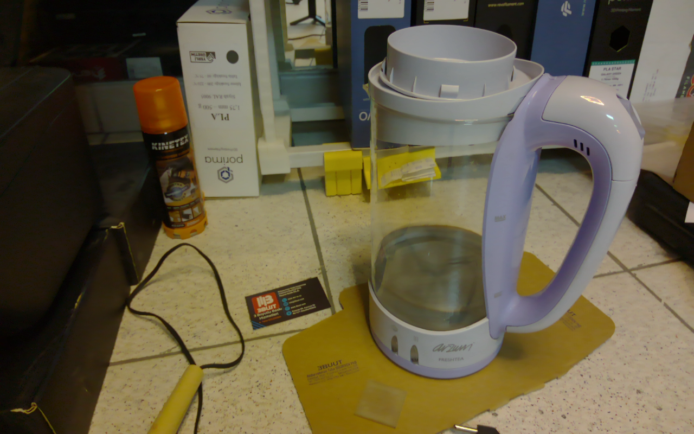
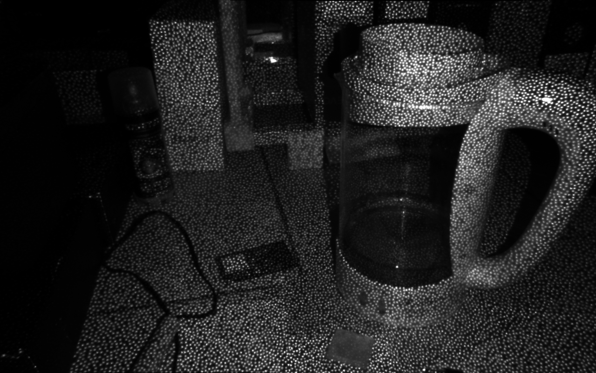
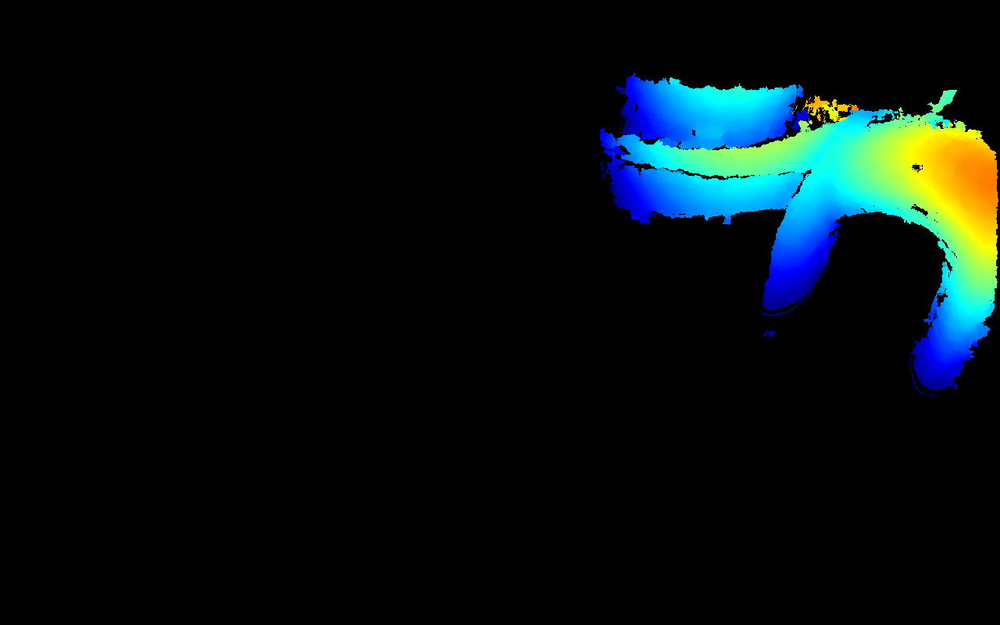

# triBUUTSCAN

*3BUUTscan* — a 3D scanning toolkit for Linux, starting with the Creality CR-Scan Ferret Pro used
directly over USB, with no Creality software.

Made in 3BUUT. Free for everyone, see [License](#license).

## Why this exists

Until now our scanning workflow was: scan with an Android phone, then move the data to Linux and
finish in CrealityScan under Bottles and Wine. It works, but it is not a smooth environment: lots of
hand-offs, and the scanner itself never talks to the Linux machine.

Now the scanner stays connected to the PC, and we can simply move it around while it streams.
The aim is to build an entire scanning setup on Linux, step by step, in the open.

We are open to testing more devices and to improvements from anyone. See
[Compatibility](#compatibility) and the [roadmap](#todo--roadmap).

## Status

**Early, but it scans.** On our one scanner:

- Live scanning works: move the scanner around an object and frames merge into one point cloud
  while you watch it grow in a browser 3D view. After Stop, an *Optimise* step ties the scan
  together (loop closures), and a rough mesh can be made from it.
- The scanner is **calibrated** with a printed board, and sizes come out right: on frames not used
  for the calibration, a 24.00 mm board square measures 24.03 mm from depth, and colour lands within
  0.3 px of depth.
- With markers on the object, tracking holds: a recent scan kept 579 of 581 frames, using about 11
  markers per frame, and Optimise's largest correction was 2.8 mm.

The limits, honestly:

- **Depth exists between about 15 and 33 cm in close range, and about 20 and 72 cm in long range.**
  Both are the scanner's own modes; the viewer's *Range* menu switches them. Long-range distances are
  an estimate until that mode is calibrated (checked once: 50 cm read as 49.3 cm).
- **Tracking runs at 3-7 frames per second** (Python on the CPU), so move slowly. Plain objects
  without markers lose tracking easily: a cardboard box at 27-31 cm tracked only 138 of 353 frames.
- **Background within range gets merged** into the scan; only the table is removed.

## Quick start

Needs Python 3.10+, numpy and tkinter. No driver: the stock `uvcvideo` module handles the device.
Light the scene and uncover the lenses, or every stream is black.

```
python3 -m tribuutscan.viewer        # live colour + IR + depth
```

For 14-bit depth (16x finer steps than the 10-bit depth V4L2 offers), allow your desktop user to
open the scanner over USB once. Without it, depth stays 10-bit and everything else works the same.

```
sudo cp udev/70-tribuutscan.rules /etc/udev/rules.d/
sudo udevadm control --reload && sudo udevadm trigger --subsystem-match=usb --attr-match=idVendor=2bc5
```

Scanning, calibration and meshing need Open3D and OpenCV, kept in a separate environment that the
viewer finds by itself:

```
python3 -m venv --system-site-packages .venv
.venv/bin/pip install "numpy<2" open3d==0.20.0 opencv-python-headless==4.10.0.84
```

The viewer shows depth large in the middle, colour and IR on the left, and folding panels on the
right: Scanner, Capture, Scan, IMU and View.

- **Start scan (c)**: stay 18-30 cm from the object (the guide line under the images shows it),
  move slowly, keep markers in view. **Stop scan (c)** saves `captures/<stamp>-scan/cloud.ply` and
  runs Optimise. Tick *keep raw frames* to keep the frames the scan used, for replays.
  *Continue last* goes on with the last saved scan.
- **Open 3D view**: the scan in the browser. *Process* has Optimise again, merge again at
  0.5 / 1 / 2 mm point distance, and Make mesh; *Export* downloads `cloud.ply` and `mesh.ply`.
- **Save frame (s)** writes one colour + IR + depth set (and a `cloud.ply`) to `captures/<stamp>/`.
  **Record (r)** writes raw sets, about 10 a second (about 49 MB/s), plus the IMU's samples
  (`imu.csv`, 200 a second), for processing later;
  **Mesh last recording (m)** makes a rough mesh from the latest one.
- Sliders set colour and IR brightness; *Auto IR* finds an IR exposure without clipping.
- **Range** switches between close (15-33 cm) and long range (about 20-72 cm, an estimate until
  calibrated); the images pause for about 10 s while the scanner switches.
- **IMU** shows the scanner's tilt (a small horizon) and how fast it turns, from its built-in
  accelerometer and gyroscope (`tribuutscan/imu.py`; needs the udev rule).

If the scanner is unplugged, the viewer asks you to plug it in and press Retry. If it goes away while
the viewer runs, the bar under the depth view turns red, it retries every 10 s, and *Retry now* tries at
once. Only one program can use the scanner at a time. The scanner also resets its USB connection a few
seconds after a program stops streaming, so give it about 5 s before starting the next one.

## Calibrating your scanner

Every unit differs a little, so calibrate your own. Without a calibration, everything runs on
rough estimates (a guessed field of view, a hand-measured depth law), and clouds come out about 13%
too narrow sideways.

```
.venv/bin/python -m tribuutscan.calibrate board          # writes captures/calib/board.svg
.venv/bin/python -m tribuutscan.calibrate capture 24.0   # your measured square size, mm
```

1. Print `board.svg` at 100% ("fit to page" off) on matte paper and measure one square with a
   ruler. Tape the page **flat** on a desk, all corners and edges. A page left on a spiral pad bowed
   by 6 mm, which the depth map showed, and that would spoil the calibration.
2. Run `capture`. Hold the scanner still over the board at about 25 different places: 18-31 cm
   away, tilted 20-40 degrees left, right, up and down, with the board in different parts of the
   picture. Each still moment at a new place is kept by itself (the images flash green); no
   keyboard needed. Press `q` to finish.
3. It solves and prints a report into `captures/calib/<stamp>/calibration.json`. If the
   reprojection errors are under about 0.5 px and the depth-law fit under 1 mm, copy that file to
   `captures/calibration.json`. Everything uses it from then on; delete it to go back to the
   estimates. (`calibrate solve captures/calib/<stamp> 24.0` solves again and writes
   `captures/calibration.json` directly.)

Our unit, for comparison: 28 views, reprojection 0.35 px (colour) and 0.32 px (IR), depth-law fit
0.30 mm.

## How a scan works

Each depth frame is paired with the colour frame captured closest in time. The object is cut out
(the table plane is found once and kept), and the frame's position is solved in one step from three
things together: the shape against the cloud so far, the markers, and a guess of the motion. Image
features (ORB) give the starting point. Each accepted frame merges into a voxel cloud: every small
cube keeps one averaged point (0.5, 1 or 2 mm), and a cube must be seen in 3 frames to be kept.
After Stop, *Optimise* looks for places the scan has seen before (shared markers, features, nearby
positions), checks them, and spreads the corrections over the whole path (a pose graph), then merges
the cloud again.

## 0-day case

The first real frame we saved, kept as-is: a glass kettle on the floor, scanner hand-held in front
of it (distance not measured). It is the starting point everything else gets compared against. Files are in
[`examples/0-day-kettle/`](examples/0-day-kettle/).

<p align="center">
  <br>
  <sub>Colour</sub>
</p>
<p align="center">
  <br>
  <sub>IR (projector dots)</sub>
</p>
<p align="center">
  <br>
  <sub>Depth (raw, near = red)</sub>
</p>

What it showed:

- Depth comes out clean and smooth, but only for the plastic handle and the lid ring, about 9% of
  the frame. The handle was the only surface inside the depth range (about 15-33 cm, confirmed
  since); the glass body gives no depth, as expected for a clear surface.
- The `cloud.ply` has 93,094 points. It was made before calibration, so it is about 13% too narrow
  sideways.

Regenerate the cloud from the saved frames (with your calibration, if you have one):
`python3 -m tribuutscan.pointcloud examples/0-day-kettle`

## What the device looks like

USB `2bc5:069c` (Orbbec vendor ID, strings "Creality" / "CR-Scan Ferret", also on the Pro). USB 3.

| Node | USB iface | Content | Format |
|---|---|---|---|
| `/dev/video0` | 1.0 | depth, 1280x800 | `Y10 `, bytesperline 1600 (packed 10-bit); 14-bit over USB only |
| `/dev/video2` | 1.2 | IR, 1280x800, dot pattern visible | GREY / MJPG |
| `/dev/video4` | 1.4 | colour, up to 1920x1080 (we use 1280x800) | YUYV / MJPG |

Odd nodes (1, 3, 5) are metadata. `/dev/hidraw*` is the scanner's motion sensor ("CR-Scan FerretIMU").
Vendor commands go through a UVC extension unit on the depth camera (Orbbec's command channel).
The IR projector turns on by itself when the IR stream is opened.

## Findings

- **Depth packing**: an MSB-first 10-bit bitstream, 4 pixels per 5 bytes. It is not MIPI Y10P.
  See `tribuutscan/depth.py`. Raw values run 1..1023, nearer = larger; 0 = invalid.
- **14-bit depth**: the depth camera also offers a 14-bit format (`Y14`, 4 pixels per 7 bytes, the
  same bitstream) that `uvcvideo` drops as an unknown format, so V4L2 never shows it. 10-bit depth
  is exactly the 14-bit value with its low 4 bits cut off: same range, but one 10-bit step is about
  0.25 mm at 26 cm, a 14-bit step 0.015 mm. `tribuutscan/usbdepth.py` streams it: it takes the
  depth function (USB interfaces 0 and 1) from `uvcvideo` through usbfs, asks for format 1 with UVC
  probe/commit and reads the bulk endpoint, while colour and IR stay on V4L2. All three run at 30
  fps together; frames are stamped from the device clock and pair with colour and IR exactly as
  before. It also carries the IR exposure and gain controls, which live on the depth function.
  If the program dies, the scanner's own USB reset gives the depth node back to `uvcvideo`.
  On a flat sheet of paper the gain is small: the surface's spread from a plane drops 3-4% (0.144 ->
  0.138 mm at 20 cm, 0.356 -> 0.345 mm at 30 cm), because the sensor's own unevenness is larger than
  the 10-bit rounding. 14-bit removes the rounding, which matters most on smooth sloped surfaces.
- **Depth modes**: the scanner holds 8 named depth modes and reports them over Orbbec's command
  channel (a UVC extension unit on the depth camera; `tribuutscan/vendor.py`): close and long range,
  each also as "Interleave" and "Narrow_View", plus two calibration modes. It starts in
  `Close_range_mode Default`, where the depth scale spans about 15 cm (1023) to 33 cm (1).
  `Long_range_mode Default` spans about 20-72 cm. Switching writes the chosen entry of the scanner's
  own list, as Orbbec's SDK does, while nothing streams; a power cycle returns it to close range.
  Careful: reading structure 1044 hung the firmware until the scanner was replugged.
- **Depth law**: distance z = a / (raw + b), settled by the board calibration (the a/z^2 form fits
  ten times worse). On our unit a = 289570 mm, b = 873.4. Earlier hand-held readings (590, 251 and
  66 at 20, 25 and 30 cm) agree with it within their +-1 cm.
- **Depth camera**: 67 degree horizontal field of view. Our first guess of 60 degrees is what made
  uncalibrated clouds about 13% too narrow.
- **Colour camera**: non-square pixels in the 1280x800 mode (focal lengths 851 and 946 px across and
  down), which fits a 16:9 sensor squeezed into 16:10. It sits about 20 mm to the side of the depth
  camera, so the colour pixel that matches a depth pixel moves with distance (parallax); the
  calibrated model handles it. A fixed colour-to-depth offset is only right at one distance: ours
  was 18 px off at 25 cm.
- **IR is mirrored** horizontally relative to colour and depth. It shows the scene only through the
  projector's dots, which break up printed codes, so the calibration finds the board in colour and
  aligns IR to it.
- **Timing**: every frame carries a kernel capture timestamp (read it before handing the buffer back
  to the driver, which clears it). All three streams run at 30 fps; colour comes 7-9 ms from depth.
  Pair frames by these times: a busy program once paired colour 90 ms away from depth.
- ffmpeg/GStreamer/OBS-style apps can't negotiate the depth format, and camera apps may pick that
  node and show black. `tribuutscan/v4l2.py` talks to V4L2 directly (raw ioctl + mmap, 64-bit offsets).
- Some depth frames arrive truncated; drop any frame shorter than `sizeimage`.
- The Orbbec SDK (`pyorbbecsdk2` 2.9.3) does not enumerate the device ("No matched usb device
  found"), although its udev rules list `2bc5:069c`.
- **Markers** (white dot in a black ring, 6 or 10 mm, placed irregularly) are found in the colour
  image; their dot usually has depth too. They make tracking far steadier.

## Layout

- Capture: `v4l2.py` (V4L2 capture, node discovery, timestamps), `usbdepth.py` (14-bit depth over
  USB), `depth.py` (depth decode), `vendor.py` (Orbbec commands: depth modes, IMU switches),
  `imu.py` (the IMU over USB), `frames.py` (frame sets, recordings, pairing by time), `image.py`
- Viewer: `viewer.py` (the window and its actions), `panels.py` (the right-hand panels),
  `livescan.py` (the scan worker process), `view3d.py` + `web/`
  (browser 3D view; three.js r160 is vendored so it works offline)
- Scanning: `cloud.py` (voxel cloud, the scanner), `track.py` (the joint solve), `features.py` (ORB),
  `markers.py` + `markermap.py`, `scene.py` (table plane, object region), `prep.py` (depth cleanup),
  `optimise.py` (loop closures, pose graph, mesh), `session.py` (continue or merge scans),
  `fuse.py` (rough TSDF mesh from a recording)
- Camera: `calib.py` (the camera model), `calibrate.py` (board calibration)
- Measuring: `evaluate.py` + `metrics.py` (tracking scores on saved and synthetic recordings),
  `synth.py` (synthetic scans with known motion), `measure.py` (depth flatness and noise),
  `compare.py` (a scan against a reference mesh of the same part),
  `pointcloud.py` (single-frame export)
- `tribuutscan-viewer.sh` launcher (copy to `~/.local/bin/tribuutscan-viewer`)
- `udev/70-tribuutscan.rules` USB access for 14-bit depth
- `examples/0-day-kettle/` the first saved frame set
- `tests/` plain test functions: run with pytest, or call them directly

## TODO / roadmap

Next up:

- [ ] **USB capture**: record the traffic between Creality's app and the scanner (usbmon, under
      Wine/Bottles or Android) while it switches size modes, to reach beyond 33 cm.
- [ ] **Speed**: tracking at 3-7 fps on the CPU; move the heavy parts to native or GPU code.
- [ ] **Object isolation**: keep the background out (a crop box in the 3D view, smarter cut-out).

Done:

- [x] **Calibration**: depth law, both cameras, colour-to-depth registration, from a printed board.
- [x] **Live scanning**: tracking (shape + markers + image features), merged cloud, Optimise with
      loop closures, continuing a scan, merging two scans.
- [x] **Markers**: detection, and tracking and alignment with them.
- [x] **Browser 3D view** with export.

Later:

- [ ] **Geometry**: cleanup and better meshing (today's mesh is a rough Poisson surface).
- [ ] **Texturing** from the colour camera.
- [ ] **A better interface**, to be built in VS Code (the viewer is a plain tkinter window).
- [ ] Packaging.

Open for everyone:

- [ ] **More device tests**: other Creality scanners, other Orbbec-vendor devices (see Compatibility).
- [ ] **An entire scanning setup**: capture, calibration, fusion, meshing and export in one workflow.

## Compatibility

Tested on exactly one setup: **Creality CR-Scan Ferret Pro**, Ubuntu (GNOME, Wayland), kernel 7.0.

Possibly related, **untested**:

- The original **CR-Scan Ferret**. The Pro identifies itself over USB with the same product string
  ("CR-Scan Ferret"), so the two may behave alike. Not verified.
- Other Creality scanners, and other Orbbec-vendor (`2bc5`) devices. Nothing here suggests they work.

Want to help? Plug your scanner in and send the output of `lsusb` and
`for d in /sys/class/video4linux/video*; do echo "$d $(cat $d/name)"; done`, then try
`python3 -m tribuutscan.viewer` and tell us which streams you get.

## Alternatives

As of October 2026 we found no other Linux support for this scanner: Creality ships no Linux
scanning software, and the Orbbec SDK we tried (`pyorbbecsdk2` 2.9.3) does not recognise it. If you
know of one, please open an issue. This project now scans to calibrated point clouds and rough
meshes, but it is early: for finished scans, Creality's Android app or CrealityScan under
Wine/Bottles is still the practical choice.

## License

MIT, see [LICENSE](LICENSE). Use it for anything, no strings attached beyond keeping the copyright
notice. Made in 3BUUT.

This is an independent project, not affiliated with or endorsed by Creality or Orbbec. Product
names belong to their owners.

This project was made with the help of Claude (Claude Sonnet 5.5 and Claude Opus 5.5, through
Claude Code), using a Claude account provided by 3BUUT.
