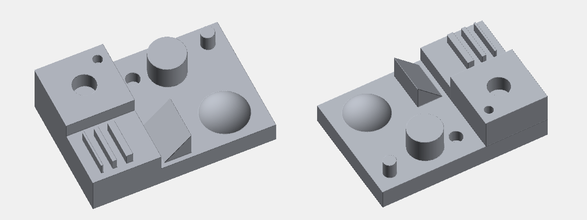
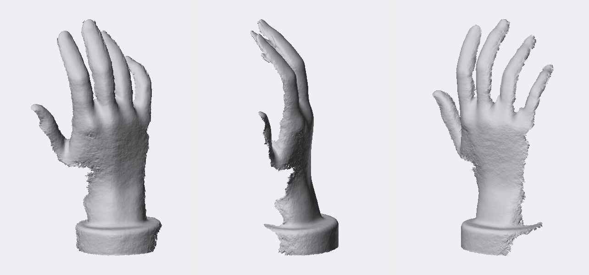
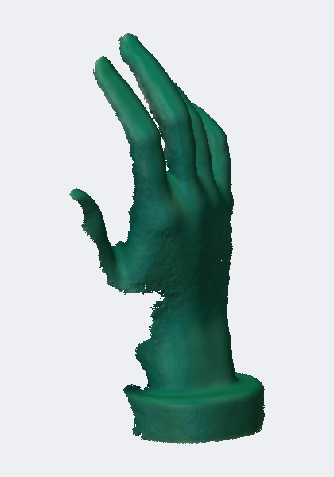
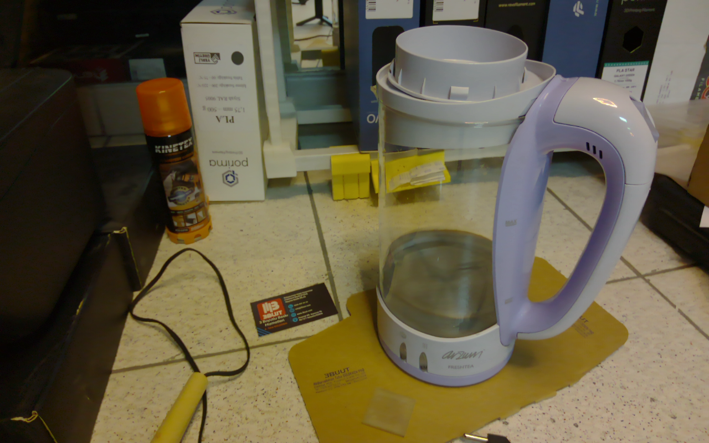
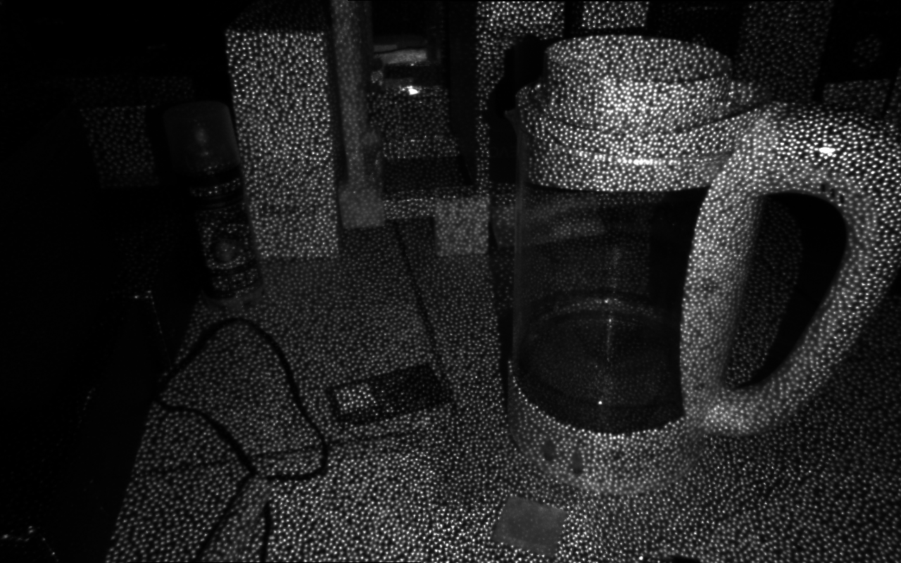
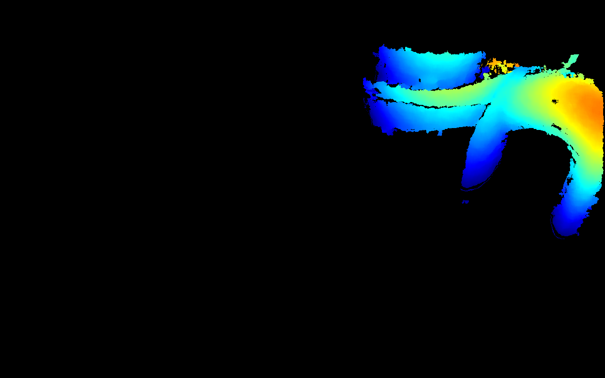

# triBUUTSCAN

*3BUUTscan* — open-source Linux software for the **Creality CR-Scan Ferret 3D scanner** (tested on
the Ferret Pro): live 3D scanning over USB into point clouds and meshes, with no CrealityScan,
Windows or Wine. Python, tested on Ubuntu.

Made in 3BUUT. Free for everyone, see [License](#license).

## Why this exists

Until now our scanning workflow was: scan with an Android phone, then move the data to Linux and
finish in CrealityScan under Bottles and Wine. It works, but it is not a smooth environment: lots of
hand-offs, and the scanner itself never talks to the Linux machine.

Now the scanner stays connected to the PC, and we can simply move it around while it streams.
The aim is to build an entire scanning setup on Linux, step by step, in the open.

We are open to testing more devices and to improvements from anyone. See
[Compatibility](#compatibility) and the [roadmap](#todo--roadmap).

## Status

**Early, but it scans.** On our one scanner:

- Live scanning works: move the scanner around an object and frames merge into one point cloud
  while you watch it grow in a browser 3D view. After Stop, an *Optimise* step ties the scan
  together (loop closures), and *Make mesh* fuses the scan's frames into a surface (PLY with colour,
  STL for slicers). On our marker part the mesh lies 0.09 mm (median) from Creality's own scan of
  it, 0.34 mm for 90% of it.
- The scanner is **calibrated** with a printed board, and sizes come out right: on frames not used
  for the calibration, a 24.00 mm board square measures 24.03 mm from depth, and colour lands within
  0.3 px of depth. Without a board, the scanner's own factory calibration is used: it is read
  automatically, and on our unit it is within 0.9 px and 0.25% of the board's.
- With markers on the object, tracking holds: a recent scan kept 579 of 581 frames, using about 11
  markers per frame, and Optimise's largest correction was 2.8 mm.
- Without markers, tracked on the GPU: a live scan of a plain mannequin hand (about 20 cm tall, long
  range, 33-39 cm away) kept every one of its 441 frames, and two separate scans of it agree to
  0.23 mm (median). See [A live scan on the GPU](#a-live-scan-on-the-gpu).

The limits, honestly:

- **Depth exists between about 15 and 33 cm in close range, and about 20 and 72 cm in long range.**
  Both are the scanner's own modes; the viewer's *Range* menu switches them. Long-range distances
  follow the scanner's own numbers for that mode, but no board calibration has been done at long
  range yet (checked once by hand: 50 cm read as 49.3 cm).
- **Live tracking runs at about 15-20 frames per second** with a GPU (20 when our hand-held
  recordings are replayed through the scan worker, 14.5 in our last live scan, made before the latest
  speed-up), and about 4 on the CPU alone, so move steadily. Plain objects need shape to hold on to: a flat cardboard box
  at 27-31 cm tracked only 138 of 353 frames with the earlier CPU tracker (not retried since).
- **Something touching the object** (the stand it rests on, a cable) stays in the scan. The table
  under it and everything around it are left out, and *Remove base* decides about the base.

## Quick start

Needs Python 3.10+, numpy and tkinter. No driver: the stock `uvcvideo` module handles the device.
Light the scene and uncover the lenses, or every stream is black.

```
python3 -m tribuutscan.viewer        # live colour + IR + depth
python3 -m tribuutscan.viewer --force-cpu   # the same, tracking and meshes on the CPU even with a GPU
```

For 14-bit depth (16x finer steps than the 10-bit depth V4L2 offers), allow your desktop user to
open the scanner over USB once. Without it, depth stays 10-bit and everything else works the same.

```
sudo cp udev/70-tribuutscan.rules /etc/udev/rules.d/
sudo udevadm control --reload && sudo udevadm trigger --subsystem-match=usb --attr-match=idVendor=2bc5
```

Scanning, calibration and meshing need Open3D and OpenCV (and `wgpu` for the GPU), kept in a separate
environment (`.venv`) that the viewer finds by itself. Build it with [uv](https://docs.astral.sh/uv/),
from the exact versions in `uv.lock`, on the same system Python the viewer runs on:

```
uv sync --all-extras                 # (plain `uv sync` leaves the extras out)
```

Without uv, `python3 -m venv .venv && .venv/bin/pip install -e ".[scan,gpu]"` works too (on
Debian/Ubuntu `python3 -m venv` needs `python3-venv`).

Tested with Python 3.12 (numpy 1.26, OpenCV 4.10 and 4.11) and Python 3.14 (numpy 2.5, OpenCV 5.0, Tk 9),
both with Open3D 0.20: the same results on every test and evaluation.

The viewer shows depth large in the middle, colour and IR on the left, and folding panels on the
right: Scanner, Capture, Scan, IMU and View.

- **Start scan (c)**: stay 18-30 cm from the object in close range, 30-50 cm in long range (the
  guide line under the images shows the distance), move steadily, keep markers in view if there are
  any. **Stop scan (c)** saves `captures/<stamp>-scan/cloud.ply`, runs Optimise and makes the mesh
  (`mesh.ply`, `mesh.stl`, `solid.ply`; *Mesh after Stop*, on by default, about 15-20 s with a GPU). *Remove base* (on
  by default) leaves the table under the object out of the result. While scanning, the depth view
  dims everything that is not the object and, with a GPU, paints the scan so far over it, as seen
  from where the scanner is: **grey** where the mesh will have the surface, **yellow** where it needs
  more views, **orange** where the scanner sees the object but the scan has nothing yet. A red frame
  means tracking is lost. The depth view then shows the scan so far where it was last seen. Move (or
  turn the object) back until the live view lines up with that grey shape, and the scan goes on. It
  also finds its place again by itself, by shape, when the scanner sees a part already scanned.
  Tick *keep raw frames* to keep the frames the scan used, for replays. *Continue last* goes on
  with the last saved scan.
- **Scanning on a platform**: the scanner can also stand still while you turn the object on a
  platform.
  - The scan notices this after a few seconds, because the room behind stays put ("object turning,
    scanner standing").
  - From then on it ignores the room's colour features: they would say nothing moved.
  - Turn slowly where the object looks thin (THIN VIEW): there its shape barely shows how far it
    turned.
  - Turn once with the scanner about level, then once more looking down at about 45°, from 30-35 cm.
    The second pass sees the top, and once the platform top shows depth it is found as the base and
    left out of the result.
- **Open 3D view**: the scan in the browser. *Process* has Optimise again, merge again at
  0.5 / 1 / 2 mm point distance, Make mesh, and Remove base / Keep base; *Show* switches between
  the cloud, the mesh and the solid (*Colour: Grey* shows the shape); *Export* downloads `cloud.ply`,
  `mesh.ply` (metres, like the cloud: the scanned surface), `mesh.stl` (millimetres, for
  slicers) and `solid.ply` (the STL's solid with the scan's colours, metres: for Blender). The STL is
  closed into a solid: what the scanner never saw (fingertips seen only from the side, the bottom of a
  stand) is filled in smoothly, and it is cut flat where the object stood on its base.
  **Crop › Crop box** draws a box around the object, with its faces level with the table (or square
  to the platform's turn). Six sliders move its faces in, and the view shows only what is inside.
  *Apply* keeps that in the cloud and makes the mesh, the STL and the solid again (the solid is cut
  flat at each face that cuts the object). *Clear crop* brings everything back.
- **Save frame (s)** writes one colour + IR + depth set (and a `cloud.ply`) to `captures/<stamp>/`.
  **Record (r)** writes colour + depth sets at 30 (or 10) a second, plus the IMU's samples
  (`imu.csv`, 200 a second), for processing later. Depth is compressed losslessly and IR is left
  out, so 30 fps takes about 75 MB/s, more when depth fills more of the view (a minute is about
  4.5 GB); recording stops by itself when
  less than 5 GB is free, and the status line shows what is left.
  **Mesh last recording (m)** tracks the latest one, optimises it and makes its mesh
  (`captures/<stamp>-scan/mesh.ply` and `mesh.stl`; a few minutes).
- Sliders set colour and IR brightness; *Auto IR* finds an IR exposure without clipping.
- **Range** switches between close (15-33 cm) and long range (about 20-72 cm); the images pause for
  about 10 s while the scanner switches.
- **IMU** shows the scanner's tilt (a small horizon) and how fast it turns, from its built-in
  accelerometer and gyroscope (`tribuutscan/imu.py`; needs the udev rule).
- Under the images, **Status** says what the viewer is doing (scanning with frames a second,
  recording, meshing, switching range), how the scanner runs (14- or 10-bit depth, range, which
  calibration), the streams' rates, the scan worker and the GPU it tracks on, and what each process
  uses: CPU, memory, GPU memory and busy time, free disk. **Messages** keeps everything the viewer
  and its helpers report (also in `captures/viewer.log`), including a meshing job's output as it runs.

If the scanner is unplugged, the viewer asks you to plug it in and press Retry. If it goes away while
the viewer runs, the bar under the depth view turns red, it retries every 10 s, and *Retry now* tries at
once. Only one program can use the scanner at a time. The scanner also resets its USB connection a few
seconds after a program stops streaming, so give it about 5 s before starting the next one.

## Calibrating your scanner

Every unit differs a little. Each time the toolkit opens the scanner it reads the scanner's own
factory calibration (kept in `captures/factory.json`) and uses it, unless you have made a board
calibration. On our unit the factory one is good (colour on depth 0.88 px, a 24.00 mm square
measures 24.06 mm); the board calibration is tighter (0.34 px, and 24.03 mm on frames it never saw),
so make one if you want the best. With neither (say,
replaying a recording on a PC that never had the scanner), everything runs on rough estimates (a
guessed field of view, a hand-measured depth law), and clouds come out about 13% too narrow sideways.
`TRIBUUTSCAN_CAMERA=board|factory|estimate` picks one by hand.

```
.venv/bin/python -m tribuutscan.calibrate board          # writes captures/calib/board.svg
.venv/bin/python -m tribuutscan.calibrate capture 24.0   # your measured square size, mm
```

1. Print `board.svg` at 100% ("fit to page" off) on matte paper and measure one square with a
   ruler. Tape the page **flat** on a desk, all corners and edges. A page left on a spiral pad bowed
   by 6 mm, which the depth map showed, and that would spoil the calibration.
2. Run `capture`. Hold the scanner still over the board at about 25 different places: 18-31 cm
   away, tilted 20-40 degrees left, right, up and down, with the board in different parts of the
   picture. Each still moment at a new place is kept by itself (the images flash green); no
   keyboard needed. Press `q` to finish.
3. It solves and prints a report into `captures/calib/<stamp>/calibration.json`. If the
   reprojection errors are under about 0.5 px and the depth-law fit under 1 mm, copy that file to
   `captures/calibration.json`. Everything uses it from then on; delete it to go back to the
   factory calibration. (`calibrate solve captures/calib/<stamp> 24.0` solves again and writes
   `captures/calibration.json` directly.)

Our unit, for comparison: 28 views, reprojection 0.35 px (colour) and 0.32 px (IR), depth-law fit
0.30 mm.

### A test block, to measure what a scan gets right

<p align="center">
  
</p>

```
python3 -m tribuutscan.testblock          # writes captures/testblock/testblock.stl (to print) and .ply
```

An 80 x 55 x 25 mm block that prints without supports (base down), with features of known size:
- steps of 8, 7 and 15 mm, and a 45 degree ramp;
- a dome, and bosses 16 and 6 mm across;
- blind holes 10, 6 and 4 mm across;
- ribs 1, 2 and 3 mm thick.

Its shape is defined exactly in `tribuutscan/testblock.py`, so a scan of the print can be measured
against it: how far the surface lies from the true one, whether the sizes are right, and which
small features survive. A print is never exactly its file, so also measure it with calipers (the
command lists what to measure). The STL is about 27 MB, closed, and within 0.1 mm of the shape.

## How a scan works

Each depth frame is paired with the colour frame captured closest in time. The object is found
where the scanner expects it to be (the table plane is found once and kept, and the object's region
stands on it), so it does not have to sit in the middle of the view. The frame's position is solved
in one step from three things together: the shape against the scan so far, the markers, and a guess
of the motion. With a GPU, the shape is matched against a view of the scan's own fused volume,
rendered from where the scanner is expected to be; without one, against the point cloud so far. A
position is taken only if it fits and the table in the frame lies as flat as the kept one. After a
loss, the frame is matched with earlier views anywhere in the scan (image features, confirmed by the
background around the object), so aiming at a part already scanned picks the scan up again.
Accepted frames feed the GPU volume, and up to four a second merge into a voxel cloud: every small
cube keeps one averaged point (0.5, 1 or 2 mm), and a cube must be seen in 3 frames to be kept.
After Stop, *Optimise* looks for places the scan has seen before (shared markers, features, nearby
positions), checks them, and spreads the corrections over the whole path (a pose graph), then merges
the cloud again. *Make mesh* fuses the merged frames once more at their corrected positions into a
surface, on the GPU in seconds.

## A live scan on the GPU

<p align="center">
  
</p>

A plain green mannequin hand (no markers), about 20 cm tall, standing on a tiled floor with
cardboard and cables around it. Scanned live in long range from 33-39 cm, about 90 degrees round
its front (2026-11-02, Intel Arc A750, with the desktop busy beside it):

| | |
|---|---|
| frames | 441 in 53 s (8.3 a second), every one tracked, none lost |
| point cloud | 131 frames merged, 141,772 points at 0.5 mm |
| Optimise | 360 loop closures, largest correction 5.4 mm |
| mesh | 219,600 triangles (177 cm2), fused on the GPU in 14 s (mostly reading the recording) |
| two scans of it | an earlier scan lies 0.23 mm (median) / 0.53 mm (90%) from this mesh and covers 91% of it within 1 mm |
| GPU | about 7 ms of work per frame (the model view 4.3 ms, matching 1.8 ms over 8 passes, preparing and fusing frames 0.7 ms), busy 12% of the time, 1.07 GB of its 8 GB memory |

The first live scan of the same hand, that morning, kept track in only 132 of 483 frames: the
tracker took whatever the middle of the view hit as the object, and a narrow object is easy to
miss. The changes made that day (see [How a scan works](#how-a-scan-works)) were tried on its
recording first: replayed, it then kept 480. The two scans agreeing shows consistency, not accuracy:
both come from the same scanner and calibration (the printed test block will tell accuracy). The back
of the hand was not scanned, and the thumb only in part.

<p align="center">
  
</p>

## 0-day case

The first real frame we saved, kept as-is: a glass kettle on the floor, scanner hand-held in front
of it (distance not measured). It is the starting point everything else gets compared against. Files are in
[`examples/0-day-kettle/`](examples/0-day-kettle/).

<p align="center">
  <br>
  <sub>Colour</sub>
</p>
<p align="center">
  <br>
  <sub>IR (projector dots)</sub>
</p>
<p align="center">
  <br>
  <sub>Depth (raw, near = red)</sub>
</p>

What it showed:

- Depth comes out clean and smooth, but only for the plastic handle and the lid ring, about 9% of
  the frame. The handle was the only surface inside the depth range (about 15-33 cm, confirmed
  since); the glass body gives no depth, as expected for a clear surface.
- The `cloud.ply` has 93,094 points. It was made before calibration, so it is about 13% too narrow
  sideways.

Regenerate the cloud from the saved frames (with your calibration, if you have one):
`python3 -m tribuutscan.pointcloud examples/0-day-kettle`

## What the device looks like

USB `2bc5:069c` (Orbbec vendor ID, strings "Creality" / "CR-Scan Ferret", also on the Pro). USB 3.

| Node | USB iface | Content | Format |
|---|---|---|---|
| `/dev/video0` | 1.0 | depth, 1280x800 | `Y10 `, bytesperline 1600 (packed 10-bit); 14-bit over USB only |
| `/dev/video2` | 1.2 | IR, 1280x800, dot pattern visible | GREY / MJPG |
| `/dev/video4` | 1.4 | colour, up to 1920x1080 (we use 1280x800) | YUYV / MJPG |

Odd nodes (1, 3, 5) are metadata. `/dev/hidraw*` is the scanner's motion sensor ("CR-Scan FerretIMU").
Vendor commands go through a UVC extension unit on the depth camera (Orbbec's command channel).
The IR projector turns on by itself when the IR stream is opened.

## Findings

- **Depth packing**: an MSB-first 10-bit bitstream, 4 pixels per 5 bytes. It is not MIPI Y10P.
  See `tribuutscan/depth.py`. Raw values run 1..1023, nearer = larger; 0 = invalid.
- **14-bit depth**: the depth camera also offers a 14-bit format (`Y14`, 4 pixels per 7 bytes, the
  same bitstream) that `uvcvideo` drops as an unknown format, so V4L2 never shows it. 10-bit depth
  is exactly the 14-bit value with its low 4 bits cut off: same range, but one 10-bit step is about
  0.25 mm at 26 cm, a 14-bit step 0.015 mm. `tribuutscan/usbdepth.py` streams it: it takes the
  depth function (USB interfaces 0 and 1) from `uvcvideo` through usbfs, asks for format 1 with UVC
  probe/commit and reads the bulk endpoint, while colour and IR stay on V4L2. All three run at 30
  fps together; frames are stamped from the device clock and pair with colour and IR exactly as
  before. It also carries the IR exposure and gain controls, which live on the depth function.
  If the program dies, the scanner's own USB reset gives the depth node back to `uvcvideo`.
  On a flat sheet of paper the gain is small: the surface's spread from a plane drops 3-4% (0.144 ->
  0.138 mm at 20 cm, 0.356 -> 0.345 mm at 30 cm), because the sensor's own unevenness is larger than
  the 10-bit rounding. 14-bit removes the rounding, which matters most on smooth sloped surfaces.
- **Depth modes**: the scanner holds 8 named depth modes and reports them over Orbbec's command
  channel (a UVC extension unit on the depth camera; `tribuutscan/vendor.py`): close and long range,
  each also as "Interleave" and "Narrow_View", plus two calibration modes. It starts in
  `Close_range_mode Default`, where the depth scale spans about 15 cm (1023) to 33 cm (1).
  `Long_range_mode Default` spans about 20-72 cm. Switching writes the chosen entry of the scanner's
  own list, as Orbbec's SDK does, while nothing streams; a power cycle returns it to close range.
  Careful: reading structure 1044 hung the firmware until the scanner was replugged.
- **Depth law**: distance z = a / (raw + b), settled by the board calibration (the a/z^2 form fits
  ten times worse). On our unit a = 289570 mm, b = 873.4. Earlier hand-held readings (590, 251 and
  66 at 20, 25 and 30 cm) agree with it within their +-1 cm.
- **Depth camera**: 67 degree horizontal field of view. Our first guess of 60 degrees is what made
  uncalibrated clouds about 13% too narrow.
- **Colour camera**: non-square pixels in the 1280x800 mode (focal lengths 851 and 946 px across and
  down), which fits a 16:9 sensor squeezed into 16:10. It sits about 20 mm to the side of the depth
  camera, so the colour pixel that matches a depth pixel moves with distance (parallax); the
  calibrated model handles it. A fixed colour-to-depth offset is only right at one distance: ours
  was 18 px off at 25 cm.
- **Factory calibration**: the scanner carries its own, readable over the same command channel
  (lists 4026 depth law, 4027 camera models, 4024 which colour/depth sizes each model is for), the
  way Orbbec's SDK reads it. It is written for horizontally mirrored depth and colour images. Read
  that way, on our unit it agrees with the board calibration: depth law within 0.5 mm across the
  close range, colour on depth within 0.9 px, a 24.00 mm square measures 24.06 mm. Its colour model
  is for 1280x720; the 1280x800 colour mode is that image stretched by 10/9. It also gives each
  depth mode's disparity offset (218 px in close, 100 px in long range), so the long-range law is
  the close one shifted by exactly 4 x 118 raw steps. The toolkit uses it when there is no board
  calibration; `python3 -m tribuutscan.vendor factory` prints it. Our marker scan replayed with it
  sits as close to Creality's own scan of the part as with the board calibration (median 0.22 against
  0.25 mm).
- **IR is mirrored** horizontally relative to colour and depth. It shows the scene only through the
  projector's dots, which break up printed codes, so the calibration finds the board in colour and
  aligns IR to it.
- **Timing**: every frame carries a kernel capture timestamp (read it before handing the buffer back
  to the driver, which clears it). All three streams run at 30 fps; colour comes 7-9 ms from depth.
  Pair frames by these times: a busy program once paired colour 90 ms away from depth.
- ffmpeg/GStreamer/OBS-style apps can't negotiate the depth format, and camera apps may pick that
  node and show black. `tribuutscan/v4l2.py` talks to V4L2 directly (raw ioctl + mmap, 64-bit offsets).
- Some depth frames arrive truncated; drop any frame shorter than `sizeimage`.
- **Garbled rows**: when the computer is slow to take the depth data, the scanner fills a run of rows
  of an otherwise normal frame with values that are not depth (down each column they step by exactly
  64 raw units). Seen over both V4L2 and USB. With a CPU-heavy job running beside it, 1 frame in 6
  had them when 8 USB transfers were kept waiting, and 0-1 in 1800 with 64. So `usbdepth.py` keeps
  64, and the decoder clears such rows (and 8 rows around them). Left in, they became sheets in the
  cloud and mesh.
- The Orbbec SDK (`pyorbbecsdk2` 2.9.3) does not enumerate the device ("No matched usb device
  found"), although its udev rules list `2bc5:069c`.
- **Markers** (white dot in a black ring, 6 or 10 mm, placed irregularly) are found in the colour
  image; their dot usually has depth too. They make tracking far steadier.
- **Meshes** (`tribuutscan/fusion.py`): the frames are fused into a truncated signed distance volume
  (0.5 mm voxels, 1.5 mm truncation) at their tracked poses, and the surface is taken from it. On the
  marker recording, against Creality's scan of the same part:

  | | median | 90% within | Creality's surface covered within 1 mm |
  |---|---|---|---|
  | point cloud (after Optimise) | 0.24 mm | 0.58 mm | 66.5% |
  | mesh | 0.09 mm | 0.34 mm | 66.1% |

  The mesh misses a thin band where the scanned area ends (a fused surface stops about a voxel
  before the last points); otherwise it covers the same. 95% of its area lies on the part; the rest
  is the stand the part leans on, which touches it. Only the keyframes are fused (the frames
  Optimise corrects): with every frame the 90% figure was 0.53 mm. On synthetic scans with known
  motion the fused surface lies 0.02-0.03 mm (median) from the true one, and a 1.8 mm plate seen from
  both sides keeps both faces (the truncation is kept under the plate's thickness for that).
- **On the GPU** (`gpu_wgpu.py`, WebGPU): set to Open3D's rules, the same volume voxel for voxel
  (Open3D's mesh and ours lie 0.00003 mm apart), with the frames cleaned, masked and coloured on the
  GPU too. The marker
  scan's mesh takes 18-24 s instead of about a minute, most of it reading the recording; the GPU's
  share is about 3 ms a frame, the mesh itself 0.2 s. Chosen over OpenCL by measuring both: the same
  results, OpenCL faster on this Intel card, but only WebGPU runs on every stock desktop's driver.
  One thing found on the way: Open3D takes each voxel's depth from the pixel it falls in rounded down,
  half a pixel off along every slope (on a synthetic sphere 0.057 mm median from the true surface);
  the GPU engine takes the nearest pixel (0.018 mm).
- **Tracking on the GPU** (`gputrack.py`): each frame is matched against a view of the scan's own
  volume rendered on the GPU from where the scanner is expected to be (KinectFusion's way), with the
  markers, the motion guess and the checks of the CPU tracker. On synthetic scans with known motion
  the camera path is 2-3 times closer to the truth (0.34-0.40 mm against 0.55-1.27 mm). On the marker
  recording every frame is tracked, the markers agree better (0.93 mm scatter, was 0.95), and the
  cloud and mesh score the same against Creality's scan, while the whole run (tracking, Optimise,
  mesh) takes 222 s instead of 314. Replays (`cloud.py`, the viewer's `m`) and live scans use it when
  there is a GPU: replayed through the live worker, the marker recording runs at 9.3 frames a second
  (3.7 on the CPU). The first live scan (a hand model at long range, 9 fps) kept track in only 132 of
  483 frames: the tracker took whatever the middle of the view hit as the object, and a narrow object
  is easy to miss. Now it looks where the object should be from the expected pose, checks each pose
  against the table the object stands on, and after a loss finds its place again anywhere already
  scanned (image features matched with earlier views, confirmed by the background around the
  object): replayed, the same recording keeps track in 480 frames. Two weak spots, both
  measured on synthetic data: a 1.8 mm plate seen edge-on (neither tracker holds that turn), and a fixed
  per-pixel depth error like the sensor's, which lets the GPU's estimate drift about 0.7 mm in the first
  frames (the CPU's 0.13). A full-rate 14-bit recording will show whether the real sensor does that.

## Layout

- Capture: `v4l2.py` (V4L2 capture, node discovery, timestamps), `usbdepth.py` (14-bit depth over
  USB), `depth.py` (depth decode), `vendor.py` (Orbbec commands: depth modes, IMU switches),
  `imu.py` (the IMU over USB), `frames.py` (frame sets, recordings, pairing by time), `image.py`
- Viewer: `viewer.py` (the window and its actions), `panels.py` (the right-hand panels),
  `livescan.py` (the scan worker process), `view3d.py` + `web/`
  (browser 3D view; three.js r160 is vendored so it works offline)
- Scanning: `cloud.py` (voxel cloud, the scanner), `merger.py` (merging in a process of its own while
  scanning live), `track.py` (the joint solve), `features.py` (ORB),
  `markers.py` + `markermap.py`, `scene.py` (table plane, object region), `prep.py` (depth cleanup),
  `optimise.py` (loop closures, pose graph), `session.py` (continue or merge scans),
  `fusion.py` (the mesh: frames fused into a TSDF volume), `gpu.py` + `gpu_wgpu.py` (the volume on
  the GPU), `gputrack.py` (tracking against it), `gpucheck.py` (a GPU self-check), `bakeoff.py` (how the GPU engine was chosen), `fuse.py`
  (ICP helpers)
- Camera: `calib.py` (the camera model), `calibrate.py` (board calibration)
- Measuring: `testblock.py` (the test block to print), `evaluate.py` + `metrics.py` (tracking scores on
  saved and synthetic recordings),
  `synth.py` (synthetic scans with known motion), `measure.py` (depth flatness and noise),
  `compare.py` (a scan or mesh against a reference mesh of the same part), `bench.py` (time per
  stage),
  `pointcloud.py` (single-frame export)
- `tribuutscan-viewer.sh` launcher (copy to `~/.local/bin/tribuutscan-viewer`)
- `udev/70-tribuutscan.rules` USB access for 14-bit depth
- `examples/0-day-kettle/` the first saved frame set
- `examples/hand-gpu-scan/` renders of the mesh from a live scan on the GPU
- `examples/testblock/` a render of the test block (`testblock.py` makes its STL)
- `tests/` plain test functions: run with pytest, or call them directly
- `docs/history.md` the working log: every measurement, what was tried and dropped

## TODO / roadmap

Next up:

- [ ] **GPU pipeline** (the top priority): depth processing, fusion, tracking against the fused model
      and meshing on the GPU, for live 20-30 fps. Vendor-neutral (any GPU with stock drivers, plus a
      CPU fallback), so it runs for everyone.
  - [x] the engine, chosen by measuring WebGPU against OpenCL: WebGPU (`wgpu`)
  - [x] meshes on the GPU: frame preparation, fusion, marching cubes (a scan's mesh in seconds)
  - [x] tracking against the fused model on the GPU (9.3 fps through the live worker, offline)
  - [x] tracking that holds a narrow object away from the middle of the view and finds its place again
        after a loss (the first live scan, replayed: 132 -> 480 of 483 frames tracked)
  - [x] the live model view: the scan so far painted over the depth view (done, needs more views,
        missing), 1 ms a frame
  - [x] live scanning at 20 fps: the hand-held and the platform recordings, replayed through the live
        worker on a busy desktop (depth unpacked on the GPU, merged in a process of its own)
  - [ ] 30 fps: the 6x6 solve on the GPU (whole ICP levels in one submission)
- [x] **Finishing** (Phase 5): the mesh made right after Stop; `mesh.stl` closed for printing and cut
      flat where the object stood; `solid.ply`, the same solid with colour, for Blender; a crop box in
      the 3D view for what touches the object (a stand, a cable). A coarser voxel for long range
      (0.75 mm) was measured and not taken: half the triangles, no closer between two scans.
- [x] **Clean-up** (Phase 6): `.venv` built with uv; the earlier tracker variants kept for comparisons
      removed (their numbers stay in `docs/history.md`); `--force-cpu` to run on the CPU on purpose.
- [ ] **Accuracy**:
  - [x] a test block to print, with known dimensions and small details (`testblock.py`)
  - [ ] the test block scanned and measured, close and long range
  - [ ] a long-range board calibration
- [ ] **IMU in tracking**: read the scanner's IMU calibration, check its clock against the depth
      frames, use the gyro as the rotation guess.

Done:

- [x] **14-bit depth** over USB: 16x finer steps than V4L2's 10-bit.
- [x] **Depth modes** through Orbbec's command channel: close (15-33 cm) and long range (about
      20-72 cm). The scanner turned out to be active stereo with two IR cameras 75 mm apart.
- [x] **IMU** readout (200 Hz), and **viewer v2** with folding panels.
- [x] **Object separation**: the base found even when the object fills the view, the object kept in a
      region on it, the base removable. On the marker part: 80% -> 92% of the points on the part,
      median distance to Creality's scan 0.69 -> 0.22 mm. Then the leaks closed (garbled depth rows,
      the base re-fitted onto the part's own face, the region spreading to neighbours): 98.6% of the
      cloud and 95% of the mesh on the part (were 92.4% and 77%), no frames without an object.

- [x] **Calibration**: depth law, both cameras, colour-to-depth registration, from a printed board.
- [x] **Factory calibration** read from the scanner and used when there is no board calibration; it
      also makes the long-range depth law exact.
- [x] **Live scanning**: tracking (shape + markers + image features), merged cloud, Optimise with
      loop closures, continuing a scan, merging two scans.
- [x] **Markers**: detection, and tracking and alignment with them.
- [x] **Browser 3D view** with export.
- [x] **Meshes** fused from the frames (a TSDF volume on the GPU, or Open3D on the CPU), shown in the
      3D view, exported as PLY and STL.

Later:

- [ ] **Texturing** from the colour camera, and surface detail from colour photos (shading, normal
      or displacement maps) where the depth is too coarse.
- [ ] **Interface polish** (viewer v2 is in place; a VS Code based interface is still an idea).
- [ ] Packaging.

Open for everyone:

- [ ] **More device tests**: other Creality scanners, other Orbbec-vendor devices (see Compatibility).
- [ ] **An entire scanning setup**: capture, calibration, fusion, meshing and export in one workflow.

## Compatibility

Tested on exactly one setup: **Creality CR-Scan Ferret Pro**, Ubuntu (GNOME, Wayland), kernel 7.0.

Possibly related, **untested**:

- The original **CR-Scan Ferret**. The Pro identifies itself over USB with the same product string
  ("CR-Scan Ferret"), so the two may behave alike. Not verified.
- Other Creality scanners, and other Orbbec-vendor (`2bc5`) devices. Nothing here suggests they work.

Want to help? Plug your scanner in and send the output of `lsusb` and
`for d in /sys/class/video4linux/video*; do echo "$d $(cat $d/name)"; done`, then try
`python3 -m tribuutscan.viewer` and tell us which streams you get.

**GPU**: meshes are fused and recordings tracked on the GPU through WebGPU (`wgpu`), which runs on
the graphics driver your system already has: Vulkan on Linux (Mesa's drivers for Intel, AMD and NVIDIA
via nouveau come with a stock Ubuntu desktop; NVIDIA's own driver has Vulkan too), DirectX 12 / Vulkan
on Windows, Metal on macOS. No CUDA, ROCm or driver upgrade is needed. Without a usable GPU it falls
back to the CPU (Mesa's llvmpipe, or Open3D and the CPU tracker); `--force-cpu` (viewer, `cloud.py`,
`fusion.py`) takes the CPU path on purpose. Tested only on an Intel Arc A750
(Mesa 25.2) and on llvmpipe. **Have an AMD or NVIDIA card, or another Intel one?** No scanner needed:

```
uv sync --all-extras && .venv/bin/python -m tribuutscan.gpucheck --out gpucheck.json
```

It fuses a synthetic sphere on your GPU and on the CPU fallback, checks the mesh against the true
sphere and times each step; please send us `gpucheck.json` (it names your OS, GPU and driver, nothing
else).

## Alternatives

Creality ships no Linux scanning software, and the Orbbec SDK we tried (`pyorbbecsdk2` 2.9.3) does
not recognise the scanner. Others are working on it too (found November 2026):
[ubuntu-ferret-scanner](https://github.com/ssjrocks/ubuntu-ferret-scanner), a Linux app (GPL-3.0),
and [OrbbecSDK_v2_WIN](https://github.com/rafik24/OrbbecSDK_v2_WIN), a Windows fork of Orbbec's SDK
that needs a patched Orbbec library. If you know of more, please open an issue. This project now scans to calibrated point clouds,
meshes and printable solids, but it is early and tested on one scanner: for finished scans, Creality's
Android app or CrealityScan under Wine/Bottles is still the safer choice.

## License

MIT, see [LICENSE](LICENSE). Use it for anything, no strings attached beyond keeping the copyright
notice. Made in 3BUUT.

This is an independent project, not affiliated with or endorsed by Creality or Orbbec. Product
names belong to their owners.

This project was made with the help of Claude (Claude Sonnet 5.5 and Claude Opus 5.5, through
Claude Code), using a Claude account provided by 3BUUT.
